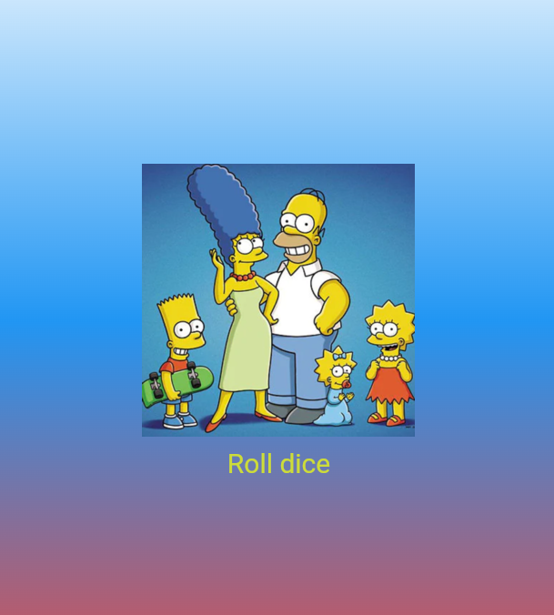

## Лабораторная работа №1
___
ФИО: Донскова Ульяна Сергеевна 
Группа: ИСП-242 
Дата: 12.10.2026
___
## Что изучили
1. Изучили, как сделать бросок кубика
2. Узнали, как работает рандом
3. Узнали, как вставлять картинки
___
## скриншот финального приложения

[Ссылка на репозиторий:](https://github.com/donskova07/Flutter_Widgets)
___
## Как запустить
- Запустить vs code
- зайти в файл main.dart
- нажать на кнопку run
___
## Ответы на вопросы
___
1. Важно делать так в создании программы, чтобы код программы был понятным и удобным в использовании
2. Buildcontext - указать для места в коде для текущего виджета. Оно нужно, чтобы виджет мог в принципе работать с приложением
3. StatelessWidget - для неизменяемых параметров.
StatefulWidget - для изменяемых параметров
4. Random() создаётся на уровне файла, чтобы была лучше производительность
